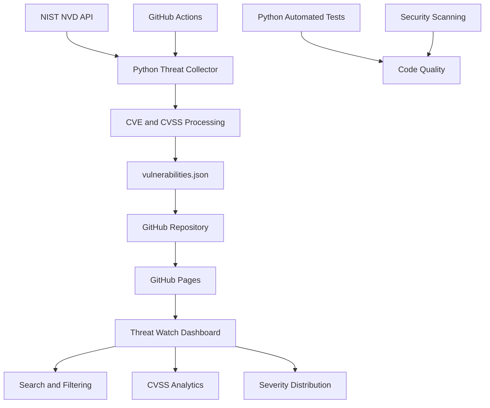

# 🛡️ Threat Watch – Cyber Threat Intelligence Dashboard

A Python-powered cybersecurity project that collects vulnerability information from the National Vulnerability Database (NVD), processes CVE records, and displays threat intelligence through an interactive web dashboard.

🔗 **Live Dashboard:** https://juliaa50.github.io/threat-watch-dashboard/

---

## 📌 Project Overview

Threat Watch is a Cyber Threat Intelligence dashboard designed to monitor publicly disclosed software vulnerabilities.

The project uses Python automation and GitHub Actions to retrieve vulnerability information from the NIST National Vulnerability Database (NVD) API.

Collected information is stored in JSON format and displayed through a web-based dashboard.

The objective is to demonstrate practical skills in:

- Cyber Threat Intelligence
- Python automation
- Vulnerability management
- REST API integration
- GitHub Actions and CI/CD
- Web development
- Security testing

---

## 🎯 Project Objectives

- Automate vulnerability information collection.
- Retrieve CVE records from the NIST NVD API.
- Extract CVSS scores and severity classifications.
- Generate structured JSON vulnerability reports.
- Automate data updates using GitHub Actions.
- Present vulnerability information through a searchable dashboard.

---

## ⚙️ Technologies Used

| Technology | Purpose |
|---|---|
| Python | Vulnerability collection and processing |
| NIST NVD API | Vulnerability intelligence source |
| Requests | HTTP API communication |
| JSON | Vulnerability data storage |
| HTML | Dashboard structure |
| CSS | Dashboard styling |
| JavaScript | Search, filtering and analytics |
| Chart.js | Data visualization |
| GitHub Actions | Workflow automation |
| GitHub Pages | Dashboard hosting |

---

## 🚀 Features

### Vulnerability Collection
- Automated NVD API requests.
- Automatic retries for temporary API failures.
- CVE identification and description extraction.
- CVSS 2.0, 3.0, 3.1 and 4.0 metric detection.

### Threat Analytics
- Total vulnerability statistics.
- Average CVSS score.
- Highest CVSS score.
- Scored and unscored vulnerability counts.
- Severity distribution visualization.

### Dashboard Functionality
- Search vulnerabilities by CVE ID.
- Filter by severity.
- Sort by CVSS score.
- Sort by publication date.
- Filter by publication date range.
- Link to individual NVD vulnerability records.

### Automation and Security
- Automated Python tests.
- Automated Python security scanning.
- Scheduled vulnerability collection.
- GitHub Actions workflow execution.

---

## 🏗️ Project Architecture



```text
             NIST NVD API
                  |
                  v
       Python Threat Collector
       scripts/collect_threats.py
                  |
                  v
       CVE and CVSS Processing
                  |
                  v
       vulnerabilities.json
                  |
                  v
          GitHub Repository
                  |
          GitHub Pages
                  |
                  v
       Threat Watch Dashboard
                  |
          Search and Analytics
```

---

## 📂 Repository Structure

```text
threat-watch-dashboard/
│
├── .github/
│   └── workflows/
│       ├── python-tests.yml
│       ├── security-scan.yml
│       └── update-threats.yml
│
├── scripts/
│   └── collect_threats.py
│
├── data/
│   └── vulnerabilities.json
│
├── index.html
├── requirements.txt
└── README.md
```

---

## 🔄 Automated Workflow

GitHub Actions automates the vulnerability collection process.

1. Checks out the repository.
2. Sets up the Python environment.
3. Installs project dependencies.
4. Executes the vulnerability collector.
5. Retrieves vulnerability records from NIST.
6. Generates the updated JSON report.
7. Commits and pushes updated vulnerability data.

---

## 🧪 Testing

The project includes automated Python testing and security scanning through GitHub Actions.

The workflows help verify code functionality and identify potential security issues.

---

## 💻 Running Locally

Clone the repository:

```bash
git clone https://github.com/Juliaa50/threat-watch-dashboard.git
```

Navigate into the project:

```bash
cd threat-watch-dashboard
```

Install dependencies:

```bash
pip install -r requirements.txt
```

Run the vulnerability collector:

```bash
python scripts/collect_threats.py
```

The generated vulnerability report is saved to:

```text
data/vulnerabilities.json
```

---

## 📊 Data Source

Vulnerability information is retrieved from:

[NIST National Vulnerability Database](https://nvd.nist.gov/)

API documentation:

https://nvd.nist.gov/developers/vulnerabilities

---

## 🔮 Future Improvements

- Expand vulnerability collection beyond the initial 20 records.
- Add vulnerability trend analysis.
- Introduce CVE vendor and product filtering.
- Add export functionality for vulnerability reports.
- Improve historical vulnerability tracking.
- Add additional threat intelligence sources.

---

## 👩‍💻 Author

**Juliaa50**

Cybersecurity Portfolio Project

---

## ⚠️ Disclaimer

This project is intended for educational and cybersecurity research purposes.

Vulnerability information is sourced from publicly available NIST NVD records.
